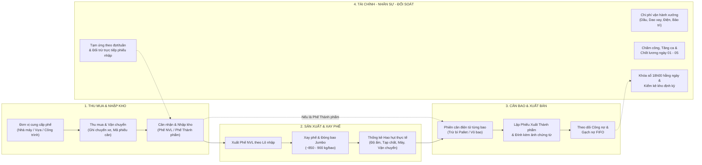
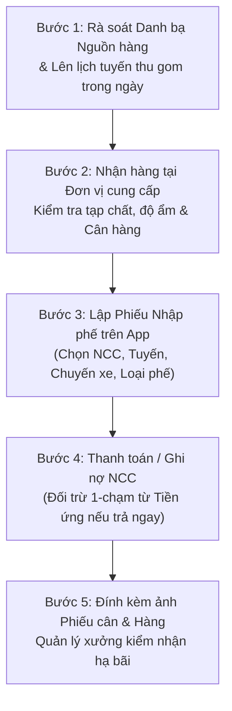
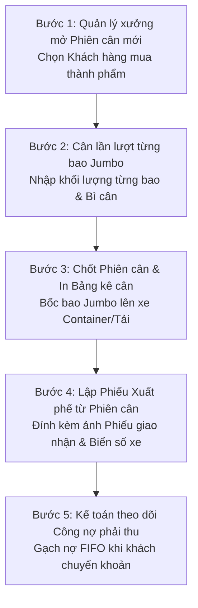

# QUY CHẾ QUẢN LÝ VÀ QUY TRÌNH VẬN HÀNH TỔNG THỂ KHO PHẾ LIỆU NHỰA (QA KHO PHẾ)

**Mã tài liệu:** QC-SOP-KHOPHE-2026  
**Phiên bản:** 1.1  
**Ngày ban hành:** 27/10/2026  
**Ngày có hiệu lực:** 01/11/2026  
**Người phê duyệt:** Giám đốc — Anh Nam  
**Phạm vi áp dụng:** Toàn bộ hoạt động thu mua, nhập kho, sản xuất (xay phế), cân đóng bao, xuất bán, quản lý tồn kho, tài chính - công nợ và nhân sự - tiền lương tại Xưởng/Kho Phế.

---

## MỤC LỤC

1. **PHẦN I: QUY CHẾ QUẢN LÝ VẬN HÀNH TỔNG THỂ KHO PHẾ**
   - Chương I: Quy định chung và Giải thích thuật ngữ
   - Chương II: Cơ cấu tổ chức, Phân công trách nhiệm và Phân quyền nghiệp vụ
   - Chương III: Quy định Quản lý Nguồn cung cấp phế và Khách hàng tiêu thụ
   - Chương IV: Quy định Quản lý Nhập kho, Sản xuất (Xay phế), Cân hàng và Xuất kho
   - Chương V: Quy định Quản lý Tài chính, Tạm ứng, Công nợ và Chi phí vận hành
   - Chương VI: Quy định Chấm công, Tăng ca và Quyết toán lương nhân sự
   - Chương VII: Kỷ luật vận hành phần mềm, Chứng từ hình ảnh và Kiểm kê đối soát
2. **PHẦN II: BỘ QUY TRÌNH TÁC NGHIỆP CHUẨN (SOP 01 – SOP 06)**
   - SOP-01: Quy trình Quản lý Nguồn hàng, Thu mua và Nhập phế về Xưởng
   - SOP-02: Quy trình Xay phế, Đóng bao Jumbo và Ghi nhận Thống kê Hao hụt
   - SOP-03: Quy trình Cân hàng Điện tử, Xuất kho Thành phẩm và Quản lý Công nợ
   - SOP-04: Quy trình Tạm ứng theo Đợt/Tuần, Đối trừ Trực tiếp và Quyết toán Hoàn ứng
   - SOP-05: Quy trình Kiểm kê Kho định kỳ và Đối soát Dữ liệu Hệ thống
   - SOP-06: Quy trình Chấm công hằng ngày và Quyết toán Lương đầu tháng
3. **PHẦN III: PHỤ LỤC MA TRẬN TRÁCH NHIỆM (RACI) VÀ DANH MỤC CHỨNG TỪ**

---

## SƠ ĐỒ TỔNG QUAN CHUỖI VẬN HÀNH KHÉP KÍN KHO PHẾ

---

# PHẦN I: QUY CHẾ QUẢN LÝ VẬN HÀNH TỔNG THỂ KHO PHẾ

## CHƯƠNG I: QUY ĐỊNH CHUNG VÀ GIẢI THÍCH THUẬT NGỮ

### Điều 1. Mục đích ban hành
1. Thiết lập khuôn khổ quản trị thống nhất, minh bạch và xuyên suốt cho toàn bộ hoạt động của Kho phế từ khâu phát triển nguồn hàng, thu mua, nhập bãi, tổ chức xay phế, cân đóng bao, xuất bán đến quản lý dòng tiền, công nợ và nhân sự.
2. Chuẩn hóa thao tác ghi nhận dữ liệu theo thời gian thực trên **Hệ thống Phần mềm Quản lý Kho phế (QA Kho Phế)**, loại bỏ tình trạng ghi sổ tay rời rạc, thất lạc phiếu cân hoặc sai lệch công nợ.
3. Làm căn cứ nội bộ để phân định rõ trách nhiệm, quyền hạn của từng vị trí công việc tại xưởng và thực hiện đối soát định kỳ.

### Điều 2. Phạm vi điều chỉnh và Đối tượng áp dụng
1. Quy chế này áp dụng bắt buộc đối với toàn bộ cán bộ quản lý, nhân viên thu mua, kế toán và công nhân vận hành máy xay, bốc xếp làm việc tại Kho phế.
2. Mọi giao dịch phát sinh liên quan đến hàng hóa (phế liệu nhựa), vật tư, tiền mặt, chuyển khoản, tạm ứng và ngày công lao động đều phải được ghi nhận đầy đủ trên phần mềm theo đúng quy định tại văn bản này.

### Điều 3. Giải thích thuật ngữ nghiệp vụ
1. **Phế Nguyên vật liệu (`Phế NVL`):** Phế liệu nhựa tấm nano, phế PVC, phế cắt đầu tấm... thu mua về ở dạng nguyên tấm/cây/mảnh lớn, bắt buộc phải qua công đoạn phân loại và đưa vào máy xay trước khi đóng bao xuất bán.
2. **Phế Thành phẩm:** Phế liệu đã qua xay nghiền đạt kích thước tiêu chuẩn (do xưởng tự xay từ Phế NVL hoặc mua gom dạng phế đã xay sẵn từ đơn vị ngoài), được đóng trong bao Jumbo sẵn sàng xuất bán.
3. **Đơn vị cung cấp phế (Nguồn hàng / NCC):** Các nhà máy sản xuất tấm nhựa, vựa phế liệu, đại lý, đội thi công công trình hoặc điểm thu gom nhỏ lẻ bán phế liệu cho xưởng.
4. **Khách hàng tiêu thụ:** Các nhà máy, công ty sản xuất nhựa thu mua phế thành phẩm từ xưởng.
5. **Phiên cân điện tử:** Lượt cân chi tiết từng bao Jumbo trước khi xuất hàng (hoặc khi kiểm tra lô hàng), ghi nhận trọng lượng từng bao và trọng lượng trừ bì.
6. **Tạm ứng theo mục đích:** Khoản tiền xưởng cấp trước cho cá nhân để thực hiện nhiệm vụ, được phân thành 03 nhóm tách biệt:
   - *Ứng mua nguyên liệu:* Tạm ứng tiền đi thu mua nguyên liệu phế.
   - *Ứng chi phí xưởng:* Tạm ứng chi phí mua vật tư, nhiên liệu, sửa chữa phục vụ xưởng.
   - *Ứng lương nhân sự:* Tạm ứng tiền lương của người lao động.
7. **Gạch nợ FIFO (`First-In, First-Out`):** Nguyên tắc thanh toán công nợ gộp cho đối tác, trong đó số tiền thanh toán được hệ thống tự động phân bổ ưu tiên tất toán cho các phiếu nhập/xuất cũ nhất còn dư nợ trước, sau đó mới đến các phiếu mới hơn.

---

## CHƯƠNG II: CƠ CẤU TỔ CHỨC, PHÂN CÔNG TRÁCH NHIỆM VÀ PHÂN QUYỀN NGHIỆP VỤ

### Điều 4. Cơ cấu tổ chức và Trách nhiệm các vị trí tại Kho phế
Hoạt động của Kho phế được điều hành bởi **Giám đốc (Chủ xưởng — Anh Nam)** và 04 bộ phận tác nghiệp trực tiếp:

1. **Giám đốc / Chủ xưởng (Anh Nam):**
   - Chịu trách nhiệm cao nhất về định hướng kinh doanh, chính sách giá thu mua và giá xuất bán thành phẩm.
   - Phê duyệt hạn mức tạm ứng tiền hàng, phê duyệt các khoản chi phí lớn, kiểm soát tổng thể tồn kho, công nợ, dòng tiền, lãi/lỗ và phê duyệt bảng quyết toán lương tháng, kết quả kiểm kê kho.
2. **Quản lý xưởng kiêm Phụ trách kho:**
   - Trực tiếp điều hành toàn bộ hoạt động sản xuất và kho bãi hằng ngày tại xưởng.
   - Kiểm nhận và cân đối chứng các chuyến phế nhập về bãi; bố trí khu vực tập kết Phế NVL và khu vực xếp bao Jumbo Thành phẩm.
   - Điều phối ca máy xay, phân công công nhân, ghi nhận Phiếu Xay phế theo lô nhập và theo dõi tỷ lệ hao hụt kỹ thuật.
   - Trực tiếp thực hiện Phiên cân điện tử từng bao Jumbo khi xuất hàng, lập Phiếu Xuất kho, chấm công hằng ngày cho công nhân và chủ trì kiểm kê tồn kho định kỳ.
3. **Bộ phận Thu mua & Phát triển nguồn hàng:**
   - Tìm kiếm, mở rộng và duy trì quan hệ với các Đơn vị cung cấp phế (nhà máy, vựa phế, công trình, đại lý).
   - Trực tiếp đi thu gom hàng hằng ngày theo tuyến, kiểm tra chất lượng phế tại nguồn, ghi nhận thông tin chuyến thu mua lên phần mềm và quản lý, quyết toán khoản tạm ứng tiền mua hàng được giao.
4. **Bộ phận Kế toán & Tài chính:**
   - Kiểm tra tính hợp lệ của các phiếu nhập, phiếu xuất, phiên cân và hình ảnh chứng từ đính kèm.
   - Quản lý sổ tạm ứng (cấp ứng, theo dõi đối trừ, thu hoàn ứng), theo dõi và thực hiện gạch nợ công nợ phải trả (NCC) / phải thu (Khách hàng), ghi nhận chi phí vận hành xưởng, đối soát dòng tiền và tổng hợp quyết toán lương đầu tháng.
5. **Tổ Sản xuất & Vận hành máy xay (Công nhân đứng máy, phân loại, xe nâng):**
   - Thực hiện phân loại tạp chất trước khi xay, vận hành máy xay an toàn, đóng bao Jumbo đúng quy chuẩn (~850 – 900 kg/bao), vệ sinh sàng máy, mài/thay dao định kỳ và bốc xếp hàng hóa.

### Điều 5. Ma trận phân quyền thao tác trên Phần mềm Quản lý Kho phế
Mỗi vị trí làm việc tại xưởng được phân quyền truy cập và thao tác trên phần mềm đúng theo chức trách nhiệm vụ:

| Nhóm nghiệp vụ trên phần mềm | Giám đốc — Chủ xưởng (Anh Nam) | Quản lý xưởng kiêm Phụ trách kho | Kế toán & Tài chính | Nhân viên Thu mua |
|---|:---:|:---:|:---:|:---:|
| **1. Xem Tổng quan vận hành (Tồn kho, Sản lượng Nhập - Xay - Xuất)** | Toàn quyền | Được phép | Được phép | Được phép |
| **2. Xem Tổng quan Tài chính (Doanh thu, Giá vốn, Lãi/Lỗ, Dòng tiền)** | Toàn quyền | Theo phân quyền Giám đốc | Được phép | Không |
| **3. Tạo mới Phiếu Nhập phế & Thêm nhanh Đơn vị cung cấp** | Toàn quyền | Được phép | Không | Được phép |
| **4. Tạo mới Phiếu Xay phế, Phiên Cân điện tử & Phiếu Xuất phế** | Toàn quyền | Được phép | Không | Không |
| **5. Sửa / Xóa Phiếu Nhập - Xay - Xuất (trước 18h00 khóa sổ)** | Toàn quyền | Được phép | Không | Không |
| **6. Quản lý Hồ sơ Đơn vị nhập phế & Khách hàng (Danh bạ)** | Toàn quyền | Được phép | Được phép | Xem & Thêm mới |
| **7. Ghi nhận Thanh toán Công nợ & Gạch nợ gộp FIFO** | Toàn quyền | Không | Được phép | Không |
| **8. Quản lý Chi phí xưởng, Sổ Tạm ứng & Đối soát tiền ứng** | Toàn quyền | Không | Được phép | Đối trừ phiếu nhập |
| **9. Chấm công hằng ngày, Hồ sơ Nhân sự & Chốt lương tháng** | Toàn quyền | Chấm công hằng ngày | Tổng hợp & Chốt lương | Không |
| **10. Lập Phiếu Kiểm kê kho & Đối soát dữ liệu hệ thống** | Toàn quyền | Được phép | Được phép | Không |
| **11. Cấu hình Định mức hệ thống & Kiểm tra Nhật ký Audit Log** | Toàn quyền | Không | Không | Không |

---

## CHƯƠNG III: QUY ĐỊNH QUẢN LÝ NGUỒN CUNG CẤP PHẾ VÀ KHÁCH HÀNG TIÊU THỤ

### Điều 6. Chuẩn hóa Hồ sơ Đơn vị cung cấp phế (Nguồn hàng)
1. Mọi đơn vị cung cấp phế từ chuyến thứ 01 trở đi đều phải được khởi tạo hồ sơ trong phân hệ **Danh bạ đối tác — Tab Đơn vị nhập phế (NCC)** (hoặc tạo nhanh trực tiếp ngay trên màn hình lập Phiếu nhập).
2. Hồ sơ một Đơn vị cung cấp phế bắt buộc phải ghi nhận đầy đủ 06 nhóm thông tin:
   - **Tên đơn vị / Bãi / Nhà máy:** Ghi rõ tên thương mại hoặc tên chủ cơ sở.
   - **Phân loại nguồn phế:**
     - `Nhà máy / Xưởng SX`: Nguồn phế phát sinh ổn định từ dây chuyền sản xuất tấm nhựa nano, PVC.
     - `Vựa phế / Đại lý`: Các đại lý, vựa thu gom trung gian có sản lượng lớn.
     - `Công trình / Đội thi công`: Nguồn phế đầu tấm phát sinh theo từng dự án thi công nội thất.
     - `Điểm thu gom / Nhỏ lẻ`: Các mối gom hàng lẻ theo chuyến.
   - **Khu vực / Tuyến thu mua:** Phân tuyến rõ ràng (ví dụ: *Đà Nẵng, Quảng Nam, TT-Huế, Quảng Trị...*) để bộ phận thu mua ghép chuyến xe tối ưu chi phí vận chuyển.
   - **Đầu mối liên hệ & Số điện thoại:** Ghi rõ tên người trực tiếp phụ trách cân/giao hàng tại bãi khách (quản đốc, thủ kho, chủ vựa).
   - **Loại phế chủ lực & Đơn giá thu mua thỏa thuận:** Hệ thống tự động điền mức giá thỏa thuận này khi tạo phiếu nhập để tránh nhầm lẫn giá giữa các đơn vị. Any điều chỉnh đơn giá vượt khung phải được **Giám đốc (Anh Nam)** thông qua.
   - **Thông tin tài khoản ngân hàng & Người phụ trách nguồn hàng.**

### Điều 7. Quy định Chăm sóc nguồn hàng và Cảnh báo ngưng giao dịch
1. Hệ thống tự động thống kê trên từng đơn vị: **Tổng khối lượng đã gom (kg)**, **Số chuyến lấy hàng**, **Ngày lấy hàng gần nhất** và **Dư nợ phải trả hiện tại**.
2. Đối với các đơn vị cung cấp phát sinh cảnh báo **"> 14 ngày chưa lấy hàng"** trên phần mềm, nhân sự phụ trách thu mua có trách nhiệm chủ động liên hệ hỏi thăm tình trạng phế tồn tại xưởng khách để lên lịch điều xe thu gom, không để đứt gãy nguồn cung.

---

## CHƯƠNG IV: QUY ĐỊNH QUẢN LÝ NHẬP KHO, SẢN XUẤT (XAY PHẾ), CÂN HÀNG VÀ XUẤT KHO

### Điều 8. Quy định Kiểm nhận và Nhập phế về Xưởng
1. **Phân loại đúng bản chất hàng nhập ngay từ đầu:**
   - Khi thu mua phế nguyên tấm, phế cây, phế cắt đầu tấm chưa qua xay nghiền: Bắt buộc chọn loại **`Phế Nguyên Vật Liệu (Phế NVL)`**. Khối lượng này được cộng vào *Tồn kho Phế NVL chờ xay*.
   - Khi thu mua phế đã xay sẵn đạt chuẩn đóng bao: Bắt buộc chọn loại **`Phế Thành phẩm`**. Khối lượng này được cộng thẳng vào *Tồn kho Thành phẩm sẵn sàng xuất bán*.
2. **Thông tin bắt buộc trên Phiếu Nhập phế:**
   - Ngày nhập thực tế, Đơn vị cung cấp phế, Người trực tiếp đi thu mua, Chuyến xe / Biển số vận chuyển, Mã phiếu cân tại nguồn (nếu cân tại trạm cân đối tác), Khối lượng tịnh sau khi trừ bì/tạp chất lớn (`kg`), Đơn giá thu mua (`đ/kg`).
3. **Kiểm soát chất lượng và đối chứng tại bãi:**
   - Khi xe chở phế về xưởng, **Quản lý xưởng kiêm Phụ trách kho** phối hợp cùng người đi thu mua kiểm tra độ ẩm, tỷ lệ lẫn tạp chất (đinh vít, nẹp kim loại, keo, bùn đất, nhựa khác chủng loại) và đối chiếu số cân trước khi hạ hàng. Nếu lô hàng lẫn tạp chất hoặc ướt mưa phải thỏa thuận trừ lùi khối lượng bì/ẩm và ghi rõ vào mục *Ghi chú chuyến hàng*.

### Điều 9. Quy định Vận hành Xay phế và Thống kê Hao hụt
1. **Nguyên tắc truy xuất theo Lô nhập:**
   - Mọi phiếu xay phế trên phần mềm bắt buộc phải chọn **Lô nhập nguyên vật liệu gốc** tương ứng.
   - Tổng khối lượng đưa vào xay của các lần xay không được vượt quá khối lượng ban đầu của lô nhập đó. Khi lô nhập đã được đưa vào xay, hệ thống tự động đồng bộ trạng thái xử lý của lô nhập sang *Đang xay* / *Hoàn thành*.
2. **Ghi nhận thực tế Đầu vào – Đầu ra và Phân loại Nguyên nhân Hao hụt:**
   - Sau mỗi ca xay hoặc mỗi lô xay, **Quản lý xưởng kiêm Phụ trách kho** ghi nhận chính xác:
     - **Khối lượng đưa vào xay (`kg`)**
     - **Khối lượng thành phẩm thu được sau xay (`kg`)**
     - **Số lượng bao Jumbo đóng được (quy chuẩn ~850 – 900 kg/bao)**
     - **Nhân công đứng máy xay**
   - Hệ thống tự động tính **Khối lượng hao hụt** và **Tỷ lệ hao hụt (`%`)**.
   - **Quy định về theo dõi hao hụt:** Xưởng áp dụng nguyên tắc **ghi nhận trung thực 100% khối lượng đầu vào - đầu ra thực tế để phục vụ thống kê kỹ thuật, chưa áp dụng chế tài phạt trừ lương đối với hao hụt**. Tuy nhiên, để Giám đốc và Quản lý xưởng có dữ liệu phân tích chất lượng từng nguồn hàng và tình trạng máy móc, mọi lô xay có hao hụt đều phải chọn đúng **Nhóm nguyên nhân hao hụt** trên phần mềm:
     - *Loại bỏ tạp chất / Phân loại:* Tách đầu keo, nẹp kim loại, nhựa tạp trước khi xay.
     - *Độ ẩm / Nước đọng:* Bay hơi nước từ phế nguyên liệu bị ướt.
     - *Hao hụt máy xay:* Bụi nhựa mịn thất thoát qua hệ thống sàng/quạt gió máy xay.
     - *Rơi vãi vận chuyển:* Rơi vãi nhẹ trong quá trình cẩu, xúc nạp liệu lên băng tải.
     - *Nguyên nhân khác:* Ghi rõ mô tả vào mục ghi chú hao hụt.

### Điều 10. Quy định Phiên Cân điện tử và Xuất kho Thành phẩm
1. **Quy trình cân từng bao bắt buộc trước khi xuất:**
   - Hàng thành phẩm xuất bán cho khách hàng được đóng trong bao Jumbo. Trước khi bốc hàng lên xe tải/container, **Quản lý xưởng kiêm Phụ trách kho** mở **Phiên cân mới**, chọn đúng Khách hàng nhận và ghi nhận trọng lượng thực tế của từng bao (`Bao #1, Bao #2...`).
   - Trường hợp cân có kèm pallet hoặc trừ bì vỏ bao/dây chằng, phải nhập chính xác tổng trọng lượng bì. Hệ thống tự động tính tổng khối lượng tịnh (`Tổng cân - Bì`).
2. **Liên kết Phiên cân vào Phiếu Xuất phế:**
   - Khi lập Phiếu Xuất phế, bắt buộc chọn **Phiên cân tương ứng** để hệ thống tự động lấy chính xác Số bao và Tổng khối lượng tịnh (`kg`).
   - Mỗi phiên cân chỉ được gắn với duy nhất 01 phiếu xuất còn hiệu lực (hệ thống tự động chặn gắn trùng phiên cân).

---

## CHƯƠNG V: QUY ĐỊNH QUẢN LÝ TÀI CHÍNH, TẠM ỨNG, CÔNG NỢ VÀ CHI PHÍ VẬN HÀNH

### Điều 11. Cơ chế Tạm ứng theo Đợt/Tuần và Đối trừ Trực tiếp
1. **Nguyên tắc cấp phát tạm ứng:**
   - Đối với hoạt động thu mua phế hằng ngày và chi tiêu vận hành tại xưởng, **Giám đốc (Anh Nam)** phê duyệt hạn mức để Kế toán thực hiện cấp **Tạm ứng theo đợt hoặc theo tuần** căn cứ vào kế hoạch thu gom hàng.
   - Khi tạo phiếu ứng trên phần mềm (`Chi phí & Ứng tiền — Tab Sổ ứng tiền`), bắt buộc chọn đúng **Mục đích khoản ứng**:
     - *Ứng mua nguyên liệu:* Cấp cho nhân sự đi thu mua phế.
     - *Ứng chi phí xưởng:* Cấp cho Quản lý xưởng mua vật tư, dầu chạy xe nâng, sửa chữa nhỏ tại bãi.
     - *Ứng lương nhân sự:* Cấp tạm ứng lương cho công nhân (bắt buộc gắn hồ sơ nhân viên).
2. **Nguyên tắc đối trừ trực tiếp trên phần mềm:**
   - Khi người đi thu mua dùng tiền tạm ứng để trả tiền phế ngay tại bãi khách, lúc lập Phiếu Nhập phế ở trạng thái *Đã thanh toán đủ*, người nhập chọn ngay mục **"Nguồn tiền thanh toán: Trừ vào tiền ứng mua hàng"** trên form Phiếu nhập (hoặc Kế toán thực hiện tại màn hình *Đối soát tiền ứng*).
   - Hệ thống tự động tạo bút toán thanh toán gắn với mã phiếu ứng gốc, đồng thời tự động trừ lùi **Số dư tạm ứng còn lại** của người ứng mà không làm lệch báo cáo dòng tiền mặt tại quỹ xưởng.
3. **Nguyên tắc quyết toán trước khi ứng đợt mới:**
   - Cuối mỗi đợt/tuần (hoặc khi số dư tạm ứng đã sử dụng trên 80%), người nhận tạm ứng phải đối chiếu toàn bộ các phiếu nhập/phiếu chi đã dùng từ tiền ứng kèm ảnh chụp chứng từ với Kế toán.
   - Phần tiền mặt còn thừa (nếu có) phải nộp hoàn ứng hoặc xác nhận số dư chuyển sang đợt kế tiếp. **Không cấp khoản tạm ứng đợt mới khi khoản ứng đợt trước chưa được phân loại mục đích và đối chiếu số dư rõ ràng trên phần mềm.**

### Điều 12. Quản lý Công nợ Phải trả (NCC) và Phải thu (Khách hàng)
1. **Theo dõi công nợ theo thời gian thực:**
   - Mọi phiếu nhập/xuất chưa thanh toán hoặc thanh toán một phần đều được hệ thống tổng hợp tự động tại phân hệ **Công nợ** và trong **Hồ sơ chi tiết từng đối tác**.
2. **Quy tắc thanh toán gộp FIFO:**
   - Khi xưởng chuyển khoản trả nợ gộp nhiều chuyến cho một Đơn vị cung cấp phế, hoặc khi Khách hàng chuyển khoản trả tiền hàng theo đợt, Kế toán sử dụng chức năng **Thanh toán gộp theo Đối tác (FIFO)**.
   - Hệ thống tự động gạch nợ tuần tự từ phiếu cũ nhất đến phiếu mới nhất, lưu rõ lịch sử từng lần trả và tự động chuyển trạng thái các phiếu đã trả đủ sang `Đã thanh toán`.
3. **Kiểm soát nợ quá hạn:**
   - Các khoản phải thu khách hàng quá **30 ngày** kể từ ngày xuất hàng chưa thu đủ tiền sẽ được hệ thống cảnh báo trên màn hình Tổng quan để Kế toán báo cáo **Giám đốc (Anh Nam)** đôn đốc thu hồi.

### Điều 13. Quản lý Chi phí Vận hành Xưởng
1. Mọi khoản chi phục vụ hoạt động sản xuất tại xưởng phải được ghi nhận đúng ngày phát sinh và phân vào đúng **08 danh mục chi phí chuẩn**:
   - `Xăng / Dầu DO`: Dầu chạy xe nâng, xe tải nội bộ.
   - `Dao cắt / Mài dao`: Mua mới hoặc gia công mài phẳng bộ lưỡi dao máy xay.
   - `Dầu máy / Mỡ bò`: Nhớt thủy lực, dầu bôi trơn ổ bi trục máy.
   - `Phụ tùng / Vật tư`: Dây curoa, bạc đạn, mặt sàng, vỏ bao Jumbo đóng hàng, dây đai.
   - `Bảo trì / Sửa chữa`: Bảo dưỡng tủ điện 3 pha, motor, băng tải, cân điện tử.
   - `Vận chuyển / Bốc xếp ngoài`: Thuê xe cẩu, xe vận tải ngoài.
   - `Nhân công thời vụ`: Chi trả bốc xếp thời vụ không thuộc biên chế lương tháng.
   - `Chi phí khác`: Tiền điện sản xuất 3 pha, tiền nước, văn phòng phẩm, tiếp khách bãi.

---

## CHƯƠNG VI: QUY ĐỊNH CHẤM CÔNG, TĂNG CA VÀ QUYẾT TOÁN LƯƠNG NHÂN SỰ

### Điều 14. Quy định Chấm công và Ghi nhận Tăng ca hằng ngày
1. Hằng ngày trước **18h00**, **Quản lý xưởng kiêm Phụ trách kho** thực hiện chấm công cho toàn bộ nhân sự làm việc trong ngày tại phân hệ **Nhân sự & Lương**:
   - **Hệ số ngày công:** `1.0` công (làm đủ ngày 8 tiếng), `0.5` công (làm nửa ngày), `1.5` công (làm thông ca).
   - **Số giờ tăng ca:** Ghi nhận số giờ làm thêm thực tế ngoài giờ hành chính. Tiền tăng ca được tính tự động theo công thức:
     $$\text{Tiền tăng ca} = \text{Số giờ tăng ca} \times \frac{\text{Lương ngày}}{8} \times \text{Hệ số tăng ca}$$
     *(Mặc định hệ số tăng ca là `1.5`, được lưu cố định trên từng bản ghi công để khi thay đổi cấu hình tương lai không làm biến động lịch sử lương cũ).*
2. Mỗi nhân sự chỉ có tối đa 01 bản ghi chấm công làm việc trong một ngày (hệ thống tự động chặn chấm trùng công).

### Điều 15. Chu kỳ Chốt bảng công và Quyết toán Lương tháng
1. **Thời gian chốt lương định kỳ:** Từ **ngày 01 đến ngày 05 đầu tháng kế tiếp**, Kế toán và Quản lý xưởng hoàn tất rà soát bảng chấm công, giờ tăng ca và các khoản tạm ứng lương phát sinh trong tháng trước để trình **Giám đốc (Anh Nam)** phê duyệt.
2. **Thực hiện Quyết toán kỳ lương trên phần mềm:**
   - Sau khi Giám đốc phê duyệt, Kế toán bấm **Chốt kỳ lương** cho từng nhân sự.
   - Hệ thống tự động kết chuyển số dư kỳ trước (nếu nhân sự ứng vượt lương tháng trước), cộng tổng lương gộp, trừ tổng tạm ứng lương và tính chính xác số tiền thực lĩnh hoặc số dư âm chuyển kỳ sau.
3. **Khóa sổ lương:** Khi kỳ lương tháng đã được chốt trên phần mềm, toàn bộ dữ liệu chấm công và tạm ứng của tháng đó được khóa cứng, nghiêm cấm mọi thao tác chỉnh sửa lùi ngày hoặc xóa bản ghi.

---

## CHƯƠNG VII: KỶ LUẬT VẬN HÀNH PHẦN MỀM, CHỨNG TỪ HÌNH ẢNH VÀ KIỂM KÊ ĐỐI SOÁT

### Điều 16. Quy định Chốt sổ 18h00 hằng ngày và Bảo vệ Dữ liệu
1. **Giờ khóa sổ hằng ngày:** Toàn bộ các phiếu phát sinh trong ngày (Phiếu Nhập phế, Phiếu Xay phế, Phiên Cân, Phiếu Xuất phế, Phiếu Chi và Chấm công) phải được nhập đầy đủ lên phần mềm **trước 18h00 cùng ngày**.
2. **Nghiêm cấm sửa/xóa phiếu của các ngày đã khóa sổ:**
   - Sau 18h00 hằng ngày, các bộ phận không được tự ý sửa đổi khối lượng, đơn giá hoặc xóa các chứng từ của ngày trước đó.
   - Trường hợp phát hiện sai sót số liệu của ngày cũ, phải báo cáo trực tiếp cho **Giám đốc (Anh Nam)** để kiểm tra và cho phép điều chỉnh; mọi thao tác thêm, sửa, xóa trên các bảng nghiệp vụ đều được hệ thống tự động lưu vết lịch sử chỉnh sửa (người thao tác, thời gian, số liệu trước và sau khi sửa).

### Điều 17. Quy định Bắt buộc Đính kèm Ảnh chụp Chứng từ
1. Để đảm bảo tính xác thực và có căn cứ đối chiếu khi xảy ra tranh chấp với nhà cung cấp hoặc khách hàng, **mọi giao dịch thu mua nhập phế, xuất bán thành phẩm, chi phí lớn và chuyển khoản công nợ đều bắt buộc đính kèm hình ảnh chứng từ gốc** ngay trên phần mềm:
   - **Đối với Phiếu Nhập phế:** Đính kèm ảnh chụp phiếu cân tại nguồn (hoặc sổ cân tại bãi), ảnh chụp lô hàng trên thùng xe (đặc biệt các lô có trừ tạp chất/độ ẩm) và ảnh màn hình chuyển khoản/biên nhận tiền mặt.
   - **Đối với Phiên Cân & Phiếu Xuất phế:** Đính kèm ảnh chụp bảng kê cân từng bao Jumbo, ảnh biển số xe/container nhận hàng và phiếu giao nhận có chữ ký tài xế/khách hàng.
   - **Đối với Chi phí & Tạm ứng:** Đính kèm ảnh hóa đơn mua dầu, hóa đơn vật tư/mài dao hoặc ảnh màn hình chuyển khoản ứng tiền.

### Điều 18. Quy định Kiểm kê Tồn kho Định kỳ và Đối soát Hệ thống
1. **Lịch kiểm kê định kỳ:**
   - **Kiểm kê giữa tháng:** Thực hiện vào chiều ngày 15 hằng tháng.
   - **Kiểm kê chốt sổ cuối tháng:** Thực hiện bắt buộc vào chiều ngày cuối cùng của tháng (ngày 30 hoặc 31).
2. **Phương pháp kiểm kê và Ghi nhận trên phần mềm:**
   - **Quản lý xưởng kiêm Phụ trách kho** phối hợp cùng Kế toán tiến hành đếm thực tế **Số lượng bao Jumbo thành phẩm tồn tại bãi**, quy đổi/cân xác suất ra **Tổng khối lượng thực tế (`kg`)** và kiểm tra khối lượng **Phế NVL chưa xay** tồn trên bãi.
   - Nhập kết quả vào phân hệ **Tồn kho — Kiểm kê kho**. Hệ thống tự động lấy **Tồn kho sổ sách tại thời điểm kiểm kê** và tính độ lệch để báo cáo Giám đốc.
3. **Rà soát trên màn hình Đối soát:**
   - Định kỳ hằng tuần và cuối tháng, Quản lý xưởng và Kế toán phải kiểm tra màn hình **Đối soát dữ liệu** để đảm bảo:
     - Không còn phiếu xay nào chưa gắn lô nhập gốc.
     - Không còn lô xay nào có hao hụt nhưng chưa phân loại nguyên nhân.
     - Không còn khoản tạm ứng nào ở trạng thái chưa phân loại mục đích.

---

# PHẦN II: BỘ QUY TRÌNH TÁC NGHIỆP CHUẨN (SOP 01 – SOP 06)

## SOP-01: QUY TRÌNH QUẢN LÝ NGUỒN HÀNG, THU MUA VÀ NHẬP PHẾ VỀ XƯỞNG

### Các bước thực hiện chi tiết:
1. **Bước 1 — Lập kế hoạch tuyến thu gom đầu ngày (07h00 – 07h30):**
   - Phụ trách thu mua mở trang **Danh bạ đối tác -> Tab Đơn vị nhập phế (NCC)**, lọc theo **Tuyến/Khu vực** và kiểm tra thẻ **"> 14 ngày chưa lấy"** để liên hệ các nhà máy, vựa phế, công trình chốt lịch bốc hàng trong ngày.
2. **Bước 2 — Kiểm tra chất lượng và Cân hàng (Trong ngày):**
   - Khi nhận hàng tại đơn vị cung cấp hoặc khi xe về trạm cân tại xưởng, kiểm tra kỹ chủng loại phế (*Tấm nhựa nano, Phế PVC trắng, Phế cắt đầu tấm...*), đánh giá độ khô ráo và tạp chất.
   - Chốt khối lượng tịnh sau trừ bì và đơn giá theo thỏa thuận.
3. **Bước 3 — Ghi nhận Phiếu Nhập phế lên phần mềm (Ngay sau khi cân):**
   - Mở trang **Danh bạ**, bấm nút **`Ghi nhập`** tại dòng đơn vị cung cấp (hoặc vào **Quản lý phế -> Tab Nhập phế -> Thêm phiếu nhập**).
   - Nếu là mối hàng mới gặp dọc đường: Bấm **`+ Thêm nhanh đơn vị mới`** ngay trong cửa sổ Phiếu nhập để lưu tên, phân loại nguồn, khu vực, SĐT và giá chuẩn.
   - Chọn đúng loại phế (`Phế NVL` hoặc `Phế Thành phẩm`), nhập khối lượng (`kg`), kiểm tra đơn giá, ghi thông tin chuyến xe và mã phiếu cân tại nguồn.
4. **Bước 4 — Xử lý thanh toán chuyến hàng:**
   - **Trường hợp 1 (Trả tiền ngay từ khoản tạm ứng mua hàng):** Chọn trạng thái `Đã thanh toán đủ` -> Chọn **Nguồn tiền thanh toán: Trừ vào tiền ứng của [Người thu mua]**. Phần mềm tự động tạo phiếu chi trả và khấu trừ số dư tạm ứng.
   - **Trường hợp 2 (Trả tiền mặt/CK trực tiếp từ quỹ xưởng):** Chọn `Đã thanh toán đủ` -> Nguồn tiền tại xưởng.
   - **Trường hợp 3 (Mua chịu / Chờ kế toán chuyển khoản gộp):** Chọn `Chưa thanh toán (Ghi nợ NCC)` hoặc `Thanh toán 1 phần`.
5. **Bước 5 — Đính kèm hình ảnh & Hạ hàng vào bãi (Trước 18h00):**
   - Mở chi tiết phiếu nhập vừa tạo, bấm **Đính kèm ảnh** để tải lên ảnh chụp phiếu cân và ảnh chuyển khoản (nếu có).
   - **Quản lý xưởng kiêm Phụ trách kho** kiểm nhận thực tế và điều phối hạ hàng đúng khu vực bãi Phế NVL (để chờ xay) hoặc khu vực Thành phẩm.

---

## SOP-02: QUY TRÌNH XAY PHẾ, ĐÓNG BAO JUMBO VÀ GHI NHẬN THỐNG KÊ HAO HỤT

| Bước | Nội dung công việc | Người thực hiện | Yêu cầu trên Phần mềm & Hiện trường |
|:---:|---|---|---|
| **1** | **Chọn lô Phế NVL đưa vào sản xuất** | Quản lý xưởng kiêm Phụ trách kho | Kiểm tra danh sách các lô nhập đang ở trạng thái `Chờ xay` trên tab **Nhập phế**. Điều phối xuất đúng lô phế ra khu vực phân loại trước máy xay. |
| **2** | **Phân loại sơ bộ & Vận hành xay** | Tổ công nhân máy xay | Tách bỏ dị vật kim loại, ốc vít, đầu keo cứng trước khi nạp liệu vào băng tải máy xay để bảo vệ lưỡi dao và mặt sàng. |
| **3** | **Đóng bao Jumbo & Xếp kho thành phẩm** | Tổ máy xay & Xe nâng | Hứng phế thành phẩm sau xay vào bao Jumbo (quy chuẩn ~850 – 900 kg/bao). Buộc kín miệng bao và dùng xe nâng di chuyển vào khu vực xếp thành phẩm. |
| **4** | **Ghi Phiếu Xay phế lên phần mềm** | Quản lý xưởng kiêm Phụ trách kho | Vào **Quản lý phế -> Tab Xay phế -> Ghi phiếu xay**: - Chọn đúng **Lô nhập gốc**. - Nhập **Khối lượng đưa vào (`kg`)** và **Khối lượng thu được (`kg`)**. - Nhập **Số bao Jumbo** và tên **Thợ đứng máy**. - Chọn đúng **Nguyên nhân hao hụt** (*Độ ẩm, Phân loại tạp chất, Bụi sàng máy, Vận chuyển*) để hệ thống thống kê kỹ thuật. |

---

## SOP-03: QUY TRÌNH CÂN HÀNG ĐIỆN TỬ, XUẤT KHO THÀNH PHẨM VÀ QUẢN LÝ CÔNG NỢ

### Các bước thực hiện chi tiết:
1. **Bước 1 — Khởi tạo Phiên cân điện tử:**
   - Khi xe của Khách hàng đến bốc hàng thành phẩm, **Quản lý xưởng kiêm Phụ trách kho** mở tab **Cân phế -> Phiên cân mới**, chọn đúng **Khách hàng nhận** và quy cách cân (*Có pallet* hoặc *Không pallet*).
2. **Bước 2 — Cân từng bao Jumbo theo thời gian thực:**
   - Mỗi bao Jumbo đưa lên bàn cân điện tử, Quản lý xưởng nhập ngay số kg vào ô trọng lượng bao và bấm thêm bao tiếp theo (`Bao #1, Bao #2...`).
   - Nhập tổng khối lượng bì (nếu có pallet/bì phụ). Hệ thống tự động cộng tổng số bao và tổng khối lượng tịnh (`kg`).
3. **Bước 3 — Lưu Phiên cân & Lập Phiếu Xuất phế:**
   - Sau khi cân xong toàn bộ các bao của chuyến xe, bấm **Lưu phiên cân**.
   - Chuyển sang tab **Xuất phế -> Thêm phiếu xuất**, chọn **Phiên cân vừa lưu**: hệ thống tự động điền Khách hàng, Số lượng bao, Tổng khối lượng (`kg`) và Đơn giá bán mặc định của khách hàng đó.
   - Kiểm tra tổng thành tiền và chọn trạng thái thanh toán (`Chưa thanh toán`, `Thanh toán 1 phần` hoặc `Đã thanh toán đủ`).
4. **Bước 4 — In Phiếu xuất & Đính kèm hình ảnh (Trước khi xe rời bãi):**
   - Bấm **In phiếu xuất** giao 01 liên cho tài xế/đại diện khách hàng ký xác nhận.
   - Chụp ảnh phiếu xuất đã ký + ảnh xe hàng đính kèm trực tiếp vào Phiếu xuất trên phần mềm.
5. **Bước 5 — Thu hồi công nợ & Gạch nợ FIFO:**
   - Khi khách hàng chuyển khoản thanh toán (trả từng chuyến hoặc trả gộp nhiều chuyến), Kế toán vào trang **Công nợ -> Tab Phải thu khách hàng**, chọn khách hàng và nhập tổng số tiền nhận được để hệ thống tự động **Gạch nợ FIFO** từ phiếu xuất cũ nhất đến mới nhất.

---

## SOP-04: QUY TRÌNH TẠM ỨNG THEO ĐỢT/TUẦN, ĐỐI TRỪ TRỰC TIẾP VÀ QUYẾT TOÁN HOÀN ỨNG

1. **Bước 1 — Phê duyệt và Cấp tạm ứng đầu đợt/đầu tuần:**
   - Căn cứ kế hoạch thu mua phế hoặc nhu cầu chi tiêu tại xưởng đã được **Giám đốc (Anh Nam)** duyệt, Kế toán vào **Chi phí & Ứng tiền -> Tab Sổ ứng tiền -> Thêm khoản ứng**.
   - Nhập Ngày ứng, Người nhận ứng, Số tiền ứng, chọn loại `Ứng tiền` và bắt buộc chọn đúng **Mục đích**:
     - Chọn `Ứng mua nguyên liệu` nếu cấp vốn đi gom phế.
     - Chọn `Ứng chi phí xưởng` nếu cấp tiền chi vận hành bãi cho Quản lý xưởng.
     - Chọn `Ứng lương` (kèm chọn tên Nhân sự) nếu công nhân ứng lương.
2. **Bước 2 — Đối trừ trực tiếp trong quá trình sử dụng:**
   - **Với tiền ứng mua nguyên liệu:** Mỗi khi lập Phiếu Nhập phế trả tiền ngay, chọn trừ trực tiếp vào khoản tạm ứng đang còn số dư của người đi thu mua.
   - **Với tiền ứng chi phí xưởng:** Khi phát sinh hóa đơn mua dầu, vật tư, sửa chữa từ tiền ứng, sau khi ghi Phiếu chi tại tab **Chi phí xưởng**, Kế toán bấm biểu tượng **Đối soát** trên dòng phiếu ứng để gắn chứng từ chi phí đó vào khoản ứng.
3. **Bước 3 — Đối chiếu số dư và Quyết toán cuối đợt/tuần:**
   - Trước khi cấp đợt ứng mới (hoặc vào chiều Thứ Bảy hằng tuần), Kế toán mở **Sổ ứng tiền** kiểm tra cột **Đã đối soát** và **Còn phải thu/đối soát**.
   - Nếu nhân sự nộp lại tiền mặt dư: Tạo phiếu `Hoàn ứng` gắn với **Phiếu ứng gốc** để tất toán số dư về `0 đ`.

---

## SOP-05: QUY TRÌNH KIỂM KÊ KHO ĐỊNH KỲ VÀ ĐỐI SOÁT DỮ LIỆU HỆ THỐNG

1. **Bước 1 — Rà soát chứng từ trước giờ kiểm kê (16h30 ngày 15 và ngày cuối tháng):**
   - **Quản lý xưởng kiêm Phụ trách kho** đảm bảo toàn bộ các chuyến phế vừa nhập về bãi và các mẻ xay đã hoàn thành trong ngày đều đã được nhập đầy đủ lên phần mềm.
2. **Bước 2 — Đếm và Cân thực tế tại Bãi (17h00 – 17h45):**
   - Quản lý xưởng phối hợp cùng Kế toán kiểm đếm tổng số bao Jumbo thành phẩm đang xếp tại kho và tính tổng trọng lượng thành phẩm thực tế (`kg`), đồng thời rà soát lượng Phế NVL chưa xay còn tồn trên bãi.
3. **Bước 3 — Ghi nhận Phiếu Kiểm kê trên phần mềm:**
   - Vào trang **Tồn kho -> Thêm phiếu kiểm kê**, nhập Số bao thực tế và Số kg thực tế. Hệ thống tự động chụp lại **Tồn kho hệ thống** tại đúng thời điểm đó và tính chênh lệch.
   - Ghi rõ nguyên nhân chênh lệch (nếu có, ví dụ: độ ẩm thay đổi, sai số quy đổi trọng lượng bình quân bao) vào phần Ghi chú và báo cáo **Giám đốc (Anh Nam)**.
4. **Bước 4 — Kiểm tra Màn hình Đối soát:**
   - Quản lý xưởng và Kế toán mở trang **Đối soát** kiểm tra các chỉ số cảnh báo hệ thống. Nếu phát hiện lô xay chưa gắn phiếu nhập hoặc khoản ứng chưa phân loại, phải xử lý dứt điểm ngay trước khi khóa sổ tháng.

---

## SOP-06: QUY TRÌNH CHẤM CÔNG HẰNG NGÀY VÀ QUYẾT TOÁN LƯƠNG ĐẦU THÁNG

1. **Bước 1 — Chấm công hằng ngày (Trước 18h00 mỗi ngày):**
   - **Quản lý xưởng kiêm Phụ trách kho** mở trang **Nhân viên -> Tab Chấm công**, chọn ngày hiện tại và tích chọn ngày công (`1 công`, `0.5 công`, `1.5 công`) kèm số giờ tăng ca thực tế cho từng nhân viên đi làm.
2. **Bước 2 — Đối chiếu bảng công cuối tháng (Ngày 01 – 02 đầu tháng sau):**
   - Kế toán mở **Bảng tổng hợp lương tháng** để Quản lý xưởng và từng nhân sự kiểm tra lại tổng số ngày công, tổng giờ tăng ca và các khoản tạm ứng lương đã nhận trong tháng.
3. **Bước 3 — Giám đốc phê duyệt, Chốt kỳ lương và Chi trả (Ngày 03 – 05 đầu tháng sau):**
   - Sau khi **Giám đốc (Anh Nam)** duyệt bảng lương, Kế toán bấm **Chốt lương tháng** trên phần mềm cho từng nhân viên.
   - Thực hiện chi trả tiền lương thực lĩnh bằng tiền mặt hoặc chuyển khoản, in Phiếu lương/Bảng quyết toán lưu hồ sơ.

---

# PHẦN III: PHỤ LỤC MA TRẬN TRÁCH NHIỆM (RACI) VÀ DANH MỤC CHỨNG TỪ

### Phụ lục 1. Ma trận Phân công Trách nhiệm (RACI)
*Chú giải: **R (Responsible)** = Người trực tiếp thực hiện; **A (Accountable)** = Người phê duyệt / Chịu trách nhiệm cuối cùng; **C (Consulted)** = Người phối hợp / Kiểm tra đối chứng; **I (Informed)** = Người được thông báo.*

| STT | Đầu việc nghiệp vụ | Giám đốc — Chủ xưởng (Anh Nam) | Quản lý xưởng kiêm Phụ trách kho | Bộ phận Thu mua | Bộ phận Kế toán |
|:---:|---|:---:|:---:|:---:|:---:|
| 1 | Mở mới & cập nhật hồ sơ Đơn vị cung cấp phế, giá thỏa thuận | A | R | R | C |
| 2 | Đi thu mua phế, cân hàng & lập Phiếu Nhập phế kèm ảnh | I | C (Kiểm nhận bãi) | R | C (Kiểm chứng từ) |
| 3 | Phân loại, điều phối máy xay & lập Phiếu Xay phế theo lô | I | R / A | I | I |
| 4 | Thực hiện Phiên cân từng bao Jumbo & lập Phiếu Xuất phế | A | R | I | C |
| 5 | Cấp phát Tạm ứng, đối trừ phiếu nhập & quyết toán hoàn ứng | A | C | C | R |
| 6 | Ghi nhận Chi phí xưởng & Gạch nợ Công nợ đối tác (FIFO) | A | C | I | R |
| 7 | Chấm công hằng ngày, ghi nhận tăng ca & Chốt lương tháng | A | R (Chấm công) | I | R (Chốt lương) |
| 8 | Kiểm kê tồn kho định kỳ & Rà soát màn hình Đối soát | A | R | I | C |

### Phụ lục 2. Danh mục Biểu mẫu và Chứng từ Điện tử chuẩn trên Phần mềm

| Mã biểu mẫu | Tên biểu mẫu / Chứng từ | Phân hệ trên phần mềm | Người lập chính | Thời hạn hoàn thành |
|:---:|---|---|---|---|
| **BM-01** | Hồ sơ Đơn vị cung cấp phế & Khách hàng | Danh bạ đối tác (`/danh-ba`) | Thu mua / Quản lý xưởng | Trước hoặc ngay khi phát sinh chuyến hàng đầu tiên |
| **BM-02** | Phiếu Thu mua / Nhập phế (kèm ảnh phiếu cân) | Quản lý phế — Nhập phế (`/quan-ly-phe?tab=nhap`) | Thu mua / Quản lý xưởng | Ngay sau khi cân hàng, muộn nhất trước 18h00 cùng ngày |
| **BM-03** | Phiếu Xay phế & Thống kê Hao hụt theo lô | Quản lý phế — Xay phế (`/quan-ly-phe?tab=xay`) | Quản lý xưởng kiêm Phụ trách kho | Cuối mỗi ca xay / Trước 18h00 hằng ngày |
| **BM-04** | Bảng kê Phiên cân điện tử từng bao Jumbo | Quản lý phế — Cân phế (`/quan-ly-phe?tab=can`) | Quản lý xưởng kiêm Phụ trách kho | Ngay khi cân bốc hàng lên xe xuất bán |
| **BM-05** | Phiếu Xuất kho Thành phẩm (In 02 liên) | Quản lý phế — Xuất phế (`/quan-ly-phe?tab=xuat`) | Quản lý xưởng kiêm Phụ trách kho | Trước khi xe chở hàng rời khỏi cổng xưởng |
| **BM-06** | Phiếu Tạm ứng / Hoàn ứng & Biên bản Đối soát ứng | Chi phí & Ứng tiền (`/chi-phi?view=ungtien`) | Kế toán | Theo từng đợt ứng; đối soát hết trước khi ứng đợt mới |
| **BM-07** | Phiếu Thanh toán Công nợ / Gạch nợ FIFO | Quản lý Công nợ (`/cong-no`) | Kế toán | Trong vòng 02 giờ sau khi phát sinh thu/chi công nợ |
| **BM-08** | Biên bản Kiểm kê Tồn kho định kỳ | Quản lý Tồn kho (`/ton-kho`) | Quản lý xưởng & Kế toán | Chiều ngày 15 và ngày cuối cùng hằng tháng |
| **BM-09** | Bảng Chấm công & Phiếu Quyết toán Lương tháng | Nhân viên & Lương (`/nhan-vien`) | Quản lý xưởng & Kế toán | Chấm công trước 18h00 hằng ngày; Chốt lương ngày 01 – 05 đầu tháng |

---

## HIỆU LỰC THI HÀNH

Quy chế và Bộ Quy trình tác nghiệp chuẩn (SOP) này do **Giám đốc — Anh Nam** phê duyệt và có hiệu lực áp dụng chính thức kể từ ngày **01/11/2026**. Toàn thể cán bộ quản lý, nhân viên thu mua, kế toán và người lao động tại Kho phế có trách nhiệm nắm vững và thực hiện nghiêm túc các quy định tại văn bản này.
